# はじめに

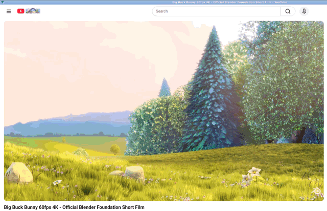

今回作った削減版の CEF(arm64、サンプルアプリ `cefsimple`)で YouTube の動画を再生している画面です。GPU のない環境で、SwiftShader も外した版なので、描画もデコードも CPU で行っています。

## CEF とは

CEF(Chromium Embedded Framework)は、Chrome のもとになっているオープンソースのブラウザ Chromium を、ほかのアプリケーションに組み込むためのフレームワークです。プロジェクトの README は、用途として次を挙げています。

- 既存のネイティブアプリに Web ブラウザの部品を埋め込む
- UI を Web 技術で作る、薄いネイティブアプリ(シェル)を作る
- 独自の描画系を持つアプリで、Web ページを画面に出さずに描画し、その画像をアプリ側で使う(オフスクリーン描画)
- Web アプリの自動テストのホストにする

同じ README は、Chromium プロジェクトが主に Chrome の開発を対象にしているのに対し、CEF は組み込み用途を対象にしていると説明しています。CEF は Chromium に C / C++ の API(`include/` 以下のヘッダ)をかぶせ、ウィンドウの生成、ページ遷移の通知、JavaScript とネイティブコードのやり取り、通信の横取り、オフスクリーン描画などをアプリから扱えるようにしています。TV やセットトップボックスのように、自社のアプリの中で Web コンテンツを表示したい機器では、この API が必要になります。

## Chromium の層の構造

Chromium のソースは、役割ごとの層に分かれています。この記事に出てくる層は次のとおりです。

| 層 | ソースの場所 | 役割 |
|---|---|---|
| Blink、V8 など | `third_party/blink`、`v8` など | Blink は HTML と CSS を処理して画面を組み立てる部分(レンダリングエンジン)、V8 は JavaScript の実行エンジン。ほかにネットワーク、描画、動画の再生などの部品がある |
| content 層 | `content/` | ブラウザの土台。ページごとにプロセスを分けて動かす仕組みや、ページ遷移の管理を受け持つ |
| //chrome 層 | `chrome/` | Chrome のブラウザ機能。設定やブックマークを持つプロファイル、自動入力、同期、拡張機能、PDF ビューア、印刷、タブやツールバーなどの UI |

Chromium のブラウザは複数のプロセスで動きます。画面とタブを管理するブラウザプロセス、ページを処理するレンダラプロセス、描画を受け持つ GPU プロセス、ネットワークなどのユーティリティプロセスです。

`content_shell` は、content 層だけで作られた最小のブラウザで、Chromium のソースに含まれています(主にテスト用)。

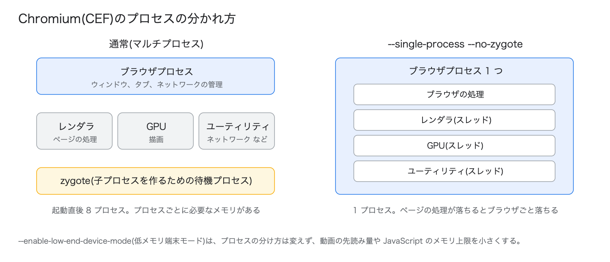

## CEF が大きくなった理由

CEF は長く、content 層の上に直接載っていて、//chrome 層は使っていませんでした。CEF のコミット履歴では、この構成が次のように変わっています。

| 日付 | コミット | 内容 |
|---|---|---|
| 2020-06-24 | `117499421` | 「Chrome ランタイム」(//chrome 層の上で動く方式)の初期対応 |
| 2020-06-28 | `84f3ff2af` | 従来の方式を「Alloy ランタイム」と改名 |
| 2024-04-17 | `dca0435d2` | Chrome ランタイムの上で、Alloy スタイル(後述)のブラウザとウィンドウに対応 |
| 2024-06-25 | `a461a8972` | Alloy ランタイムの起動経路を削除。CEF の 6613 ブランチ(Chromium 128)以降に含まれる |

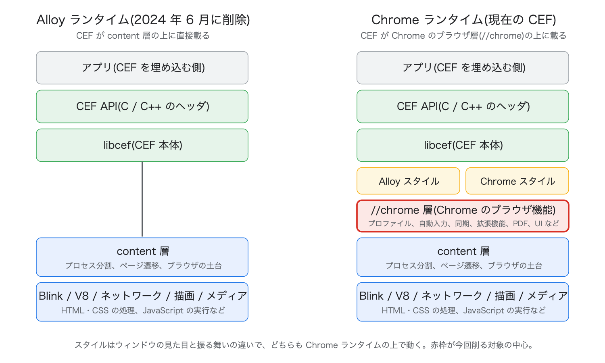

その結果、現在の CEF は必ず //chrome 層の上で動きます。CEF 本体(`libcef.so`)は、`ChromeMainDelegate`、`ChromeContentBrowserClient`、`ChromeContentRendererClient` など //chrome のクラスを継承して作られています。設定や Cookie を保持する単位も Chrome のプロファイル(`Profile`)です。CEF 本体の 76 ファイルが `chrome/` 以下のヘッダを計 172 回 include しています。こうして、自動入力、同期、パスワード管理、拡張機能、PDF ビューア、印刷、ブラウザの UI など、組み込み用途で使わない機能もまとめてリンクされます。

## Alloy スタイルと Chrome スタイル

現在の CEF では、ウィンドウ(ブラウザ)ごとに 2 つのスタイルのどちらかを選びます。CEF のヘッダ `include/internal/cef_types_runtime.h` の説明は次のとおりです。

| スタイル | 内容 |
|---|---|
| Chrome スタイル | Chrome の UI とブラウザ機能をそのまま持つ(タブ、ツールバー、メニューなど) |
| Alloy スタイル | 既定のブラウザ機能は少ないが、アプリ向けのコールバックが多く、オフスクリーン描画に対応する |

どちらのスタイルも Chrome ランタイムの上で動きます。オフスクリーン描画は常に Alloy スタイルです。今回は、組み込み用途に近い Alloy スタイルを対象にしました。CEF に付属するサンプルアプリ `cefsimple` を `--use-alloy-style` で起動して、サイズと動作を確かめています。

## 調査の目的

ローエンドの機器(TV など)に組み込んで Web 閲覧に使えるように、CEF の最新リリース版の ROM(機器に載せるファイルのサイズ)と RAM の使用量を、どこまで、どの方法で減らせるかを調べました。条件は、Chrome のブラウザ機能を外しても、CEF の API と YouTube の再生が動くことです。

# 結果

以降、CEF に何も手を加えずにビルドしたものを「CEF 既定」、後述の削減をすべて入れたものを「削減版」と呼びます。主な値は次のとおりです(arm64)。

| 項目 | CEF 既定 | 削減版 + 3 フラグ | 削減版 + UPX + 3 フラグ |
|---|---|---|---|
| ROM(配布物) | 366.3MB | 196.0MB(−46.5%) | 95.3MB(−74.0%) |
| H.264 1080p60 再生中の RAM(PSS) | 1,045.5MiB | 684.4MiB(−35%) | 681.5MiB(−35%) |
| H.264 1080p60 再生中の回収できない RAM | 790.0MiB | 531.2MiB(−33%) | 679.0MiB(−14%) |
| AV1 4K60 再生中の RAM(PSS) | 1,509.5MiB | 1,005.5MiB(−33%) | 未計測 |

削減版は SwiftShader を外したもの、3 フラグは RAM を減らす 3 つの起動フラグ、UPX は実行ファイルの圧縮ツールです。CEF 既定は起動フラグなしの値です。それぞれの意味と、ほかの組み合わせの値は以下の節に書きました。

## ROM

| CPU | 構成 | 実行ファイル | 配布物 |
|---|---|---|---|
| x64 | CEF 既定 | 299.6MB | 377.5MB |
| x64 | 削減版 | 191.2MB(−36.2%) | 206.6MB(−45.3%) |
| arm64 | CEF 既定 | 275.1MB | 366.3MB |
| arm64 | 削減版 | 186.7MB(−32.1%) | 219.6MB(−40.0%) |
| arm64 | 削減版、SwiftShader なし | 186.7MB(−32.1%) | 196.0MB(−46.5%) |
| arm64 | 削減版、SwiftShader なし + UPX | 86.1MB(−68.7%) | 95.3MB(−74.0%) |

- 削減の作業は、調べやすい x64(PC)で進め、最後に同じ変更を、TV などの組み込み機器の SoC で使われる arm64 に当てました。
- 実行ファイルは `libcef.so` と `cefsimple` の合計で、デバッグ用のシンボルを取り除いた(strip した)サイズです。
- 配布物は、実行ファイルに、実行時に読むデータとライブラリを足した合計です。主なものは、画像や HTML などのリソースをまとめた `.pak` ファイル、文字列処理と国際化のライブラリ ICU のデータ、V8 の起動用データ、OpenGL ES の窓口になるライブラリ(`libEGL.so`、`libGLESv2.so`)です。OpenGL ES の呼び出しを各 GPU の API に変換する ANGLE の本体は `libcef.so` に入っています。ロケールは ja と en-US だけを数えています(全 220 ロケールでは +50.5MB)。動画の DRM(Widevine)の復号モジュール(約 21MB、初回起動時に取得)は含みません。
- SwiftShader は、GPU の処理を CPU で行うソフトウェア実装です。GPU のない環境でも GPU 向けの処理(GPU での合成や WebGL)を動かすために CEF に同梱されています。GPU のある機器では要らないので、外した場合の値も示しました。SwiftShader を外しても、GPU のない計測環境で画面は描けます。使えなくなるのは WebGL です(理由は「SwiftShader がなくても描画できる理由」の節)。
- UPX は、実行ファイルを圧縮しておき、起動時にメモリ上で展開するツールです。`libcef.so` と `cefsimple` を圧縮しました。ROM は減りますが、展開したコードは回収できない RAM になります(下の RAM の表と「UPX で圧縮する」の章)。

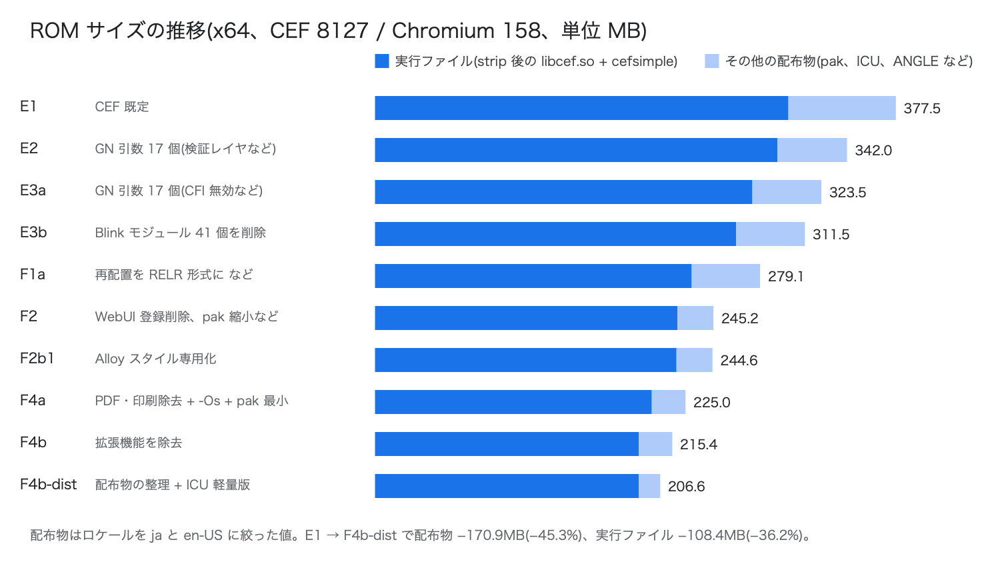

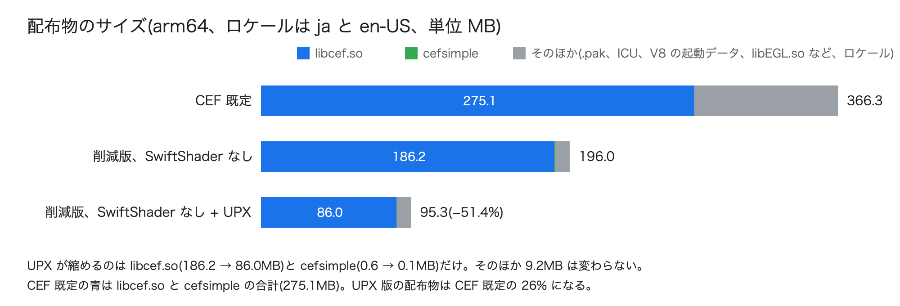

## RAM(arm64)

RAM の値は 2 種類を使っています。詳しくは「計測方法」に書きました。

- **PSS**: プロセスが使っているメモリのうち、ほかのプロセスと共有している分を按分して数えた量。全プロセスの合計を使った
- **回収できない RAM**: メモリが足りなくなってもカーネルが捨てられない分(プログラムが確保したメモリなど)。実行ファイルを読み込んだ分のように、捨てても読み直せる分(ファイル由来の RAM)は含まない

表では、PSS を「A: 回収できない分のうちプロセスが触ったページ」と「B: ファイル由来の RAM」に分けて示し、PSS = A + B になるようにしました(3 回の中央値をそれぞれ取っているので、合計が 0.2MiB ほどずれることがある)。A と B は各プロセスのメモリの内訳(`/proc/<pid>/smaps_rollup`)の値です。右端の「回収できない RAM(cgroup)」は、ブラウザのプロセスをまとめて数える Linux の仕組み(cgroup)の値で、どのプロセスもまだ触っていないページも含みます。ふだんは A より 0.2〜9MiB 大きいだけですが、後述の UPX では大きく離れます。

ビルドを変えずに、起動時の指定だけで RAM を減らせる起動フラグも試しました。次の 3 つで、以降まとめて「3 フラグ」と呼びます。

| 起動フラグ | 内容 |
|---|---|
| `--single-process` | ブラウザ、レンダラ、GPU などをすべて 1 つのプロセスで動かす |
| `--no-zygote` | 子プロセスを作るための待機プロセス(zygote)を使わない |
| `--enable-low-end-device-mode` | 低メモリ端末モード。動画の先読み量や JavaScript のメモリ上限などを小さくする |

起動直後(ローカルのテストページを開いて 30 秒後、3 回の中央値):

| 起動フラグ | 構成 | PSS(A + B) | A: 回収できない分のうちプロセスが触ったページ | B: ファイル由来の RAM | 回収できない RAM(cgroup) |
|---|---|---|---|---|---|
| なし | CEF 既定 | 387.6MiB | 159.2MiB | 228.7MiB | 160.5MiB |
| なし | 削減版 | 286.7MiB(−26.0%) | 127.5MiB | 159.4MiB(−30.3%) | 128.8MiB(−19.8%) |
| なし | 削減版、SwiftShader なし | 234.7MiB(−39.4%) | 93.8MiB | 141.0MiB(−38.3%) | 101.8MiB(−36.6%) |
| なし | 削減版、SwiftShader なし + UPX | 336.5MiB(−13.2%) | 309.4MiB | 27.1MiB(−88.2%) | **715.4MiB(+345.7%)** |
| 3 フラグ | CEF 既定 | 266.1MiB | 58.0MiB | 208.2MiB | 65.7MiB |
| 3 フラグ | 削減版、SwiftShader なし | 188.5MiB(−29.2%) | 48.8MiB | 139.7MiB(−32.9%) | 56.7MiB(−13.7%) |
| 3 フラグ | 削減版、SwiftShader なし + UPX | 188.5MiB(−29.2%) | 162.9MiB | 25.6MiB(−87.7%) | **210.0MiB(+219.6%)** |

括弧内は、同じ起動フラグの CEF 既定との比較です。3 フラグの行は、GPU デバイスがないので `--disable-gpu` も付けて測りました。UPX で圧縮するには、リンクの方法と PartitionAlloc(メモリ確保の部品)の 2 か所を変える必要があります(「UPX で圧縮する」の章)。この 2 つの変更を入れた圧縮前の版は、削減版、SwiftShader なしと同じ値でした(PSS 235.3MiB、cgroup 102.1MiB)。3 フラグの「削減版、SwiftShader なし」の行は、この圧縮前の版で測りました。

UPX では、PSS はあまり変わらないのに、回収できない RAM(cgroup)が大きく増えます。展開したコードが、ファイル由来の RAM(B)から、カーネルが捨てられない共有メモリ(A と cgroup)に移るためです。プロセスが触っていないコードも cgroup にだけ入るので、cgroup が PSS を超えます(「UPX で圧縮する」の章)。

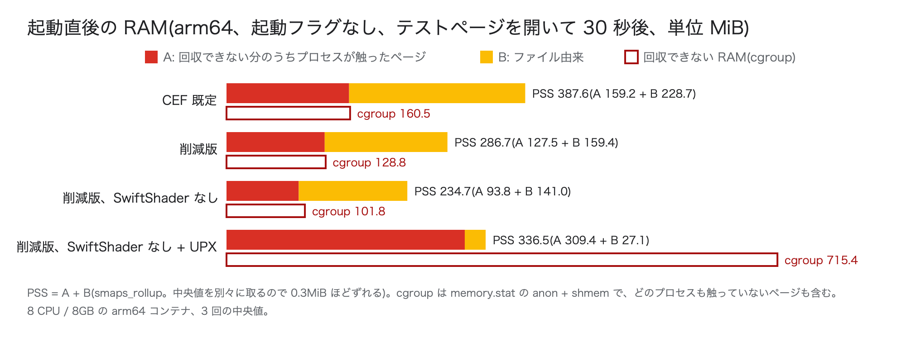

YouTube の動画を再生している間(全プロセスの PSS、最後まで再生できた 2 回の中央値):

| 動画 | CEF 既定 | CEF 既定 + 起動フラグ | 削減版 | 削減版 + 起動フラグ | 削減版 + UPX | 削減版 + UPX + 起動フラグ |
|---|---|---|---|---|---|---|
| H.264 1080p60 | 1,045.5MiB | 912.2MiB(−13%) | 759.3MiB(−27%) | **684.4MiB(−35%)** | 887.6MiB(−15%) | 681.5MiB(−35%) |
| AV1 4K60 | 1,509.5MiB | 1,348.7MiB(−11%) | 1,131.9MiB(−25%) | **1,005.5MiB(−33%)** | 未計測 | 未計測 |

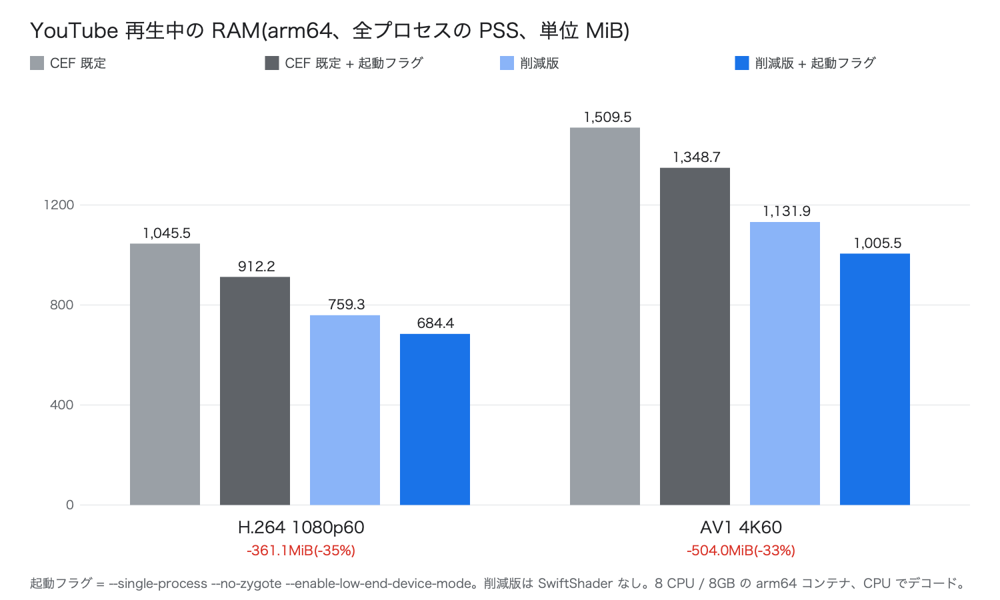

この表の削減版は SwiftShader なしのものです。表の「起動フラグ」は 3 フラグです。PSS には UPX の負担が一部しか出ないので、H.264 1080p60 の再生中について、回収できない RAM(cgroup)も示します。

| 動画 | CEF 既定 | CEF 既定 + 起動フラグ | 削減版 | 削減版 + 起動フラグ | 削減版 + UPX | 削減版 + UPX + 起動フラグ |
|---|---|---|---|---|---|---|
| H.264 1080p60 | 790.0MiB | 661.9MiB(−16%) | 601.6MiB(−24%) | 531.2MiB(−33%) | **1,366.2MiB(+73%)** | 679.0MiB(−14%) |

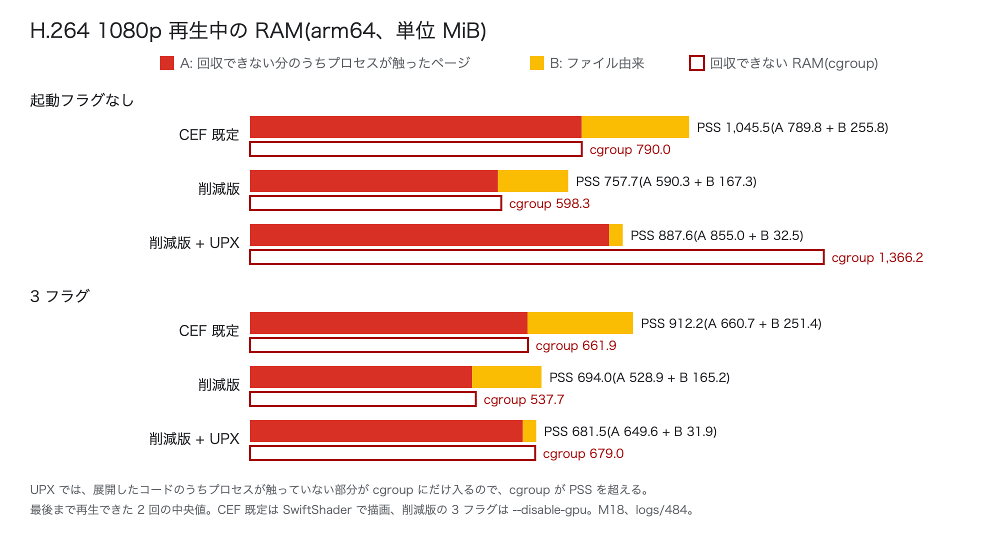

UPX の 2 列は、UPX 用の 2 つの変更を入れた削減版を圧縮したもので、圧縮前の値は削減版とほぼ同じです(PSS 757.7 と 694.0MiB)。上の図の「削減版」はこの圧縮前の値です。

ブラウザが使えるメモリに上限をかけ、120 秒間再生できるかを確かめた結果(起動フラグあり):

| 動画 | CEF 既定 | 削減版 | 削減版 + UPX |
|---|---|---|---|
| H.264 1080p60 | 880MiB で再生できた(780MiB では強制終了) | 640MiB で再生できた | 未確認 |
| AV1 4K60 | 1,320MiB で再生できた | 980MiB で再生できた | 未確認 |

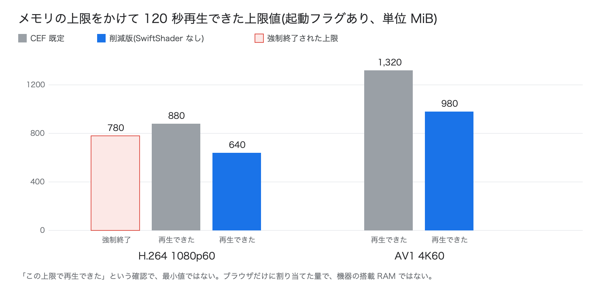

これは「この上限で再生できた」という確認で、再生できる最小値ではありません。上限はブラウザだけに割り当てた量で、機器の搭載 RAM ではありません。

RAM の値は、動画のデコードも描画も CPU で行う環境での測定です(「計測方法」を参照)。ハードウェアデコーダのある機器では、デコード済みのフレームがドライバ側に置かれるので、ブラウザ側の値はこれより小さくなる見込みです(未計測)。

## UPX の評価

削減版に UPX をかけると、ROM は半分になりますが、展開したコードを自分で持つプロセス 1 つにつき、回収できない RAM が約 153MiB 増えます。3 フラグと組み合わせると、回収できない RAM にファイル由来の RAM を足した値の増加は 8〜39MiB です。再生中の回収できない RAM は、CEF 既定を同じ 3 フラグで動かした場合とほぼ同じ(661.9 と 679.0MiB)で、ROM は 26% です。ROM と RAM のどちらが厳しいかで使い分けます(「UPX を使うべきか」)。削減版、SwiftShader なしの配布物のファイル(194.6MB)を圧縮ファイルシステム squashfs に入れると 60.7MB(xz)で、UPX より小さくなりました(RAM は未計測)。

# 調査対象

| 対象 | 版 | 入手元 |
|---|---|---|
| CEF | 8127 ブランチ、コミット `6ee3fb965`("Update to Chromium version 158.0.8127.18"、2026-11-10) | https://github.com/chromiumembedded/cef |
| Chromium | 158.0.8127.18(タグ、コミット `6449d9f9a6`) | https://chromium.googlesource.com/chromium/src |
| 比較用の Chromium | 159.0.8143.0(`content_shell` と `chrome` の比較に使用) | 同上 |

CEF のブランチ番号は、対応する Chromium のブランチ番号と同じです。調査を始めた 2026-11-10 の時点で、CEF の 8127 ブランチ(Chromium 158)は Beta、Stable は 8078 ブランチ(Chromium 156)でした。Chromium 159 に対応した CEF はまだなかったので、8127 を使いました。

CEF の取得用スクリプト `automate-git.py` を既定の設定で使うと、Chromium の全履歴を取りにいきます。そこで次の手順に分けて取得しました。

1. Chromium のタグ `158.0.8127.18` だけを `git fetch --depth=1` で取得する
2. 依存リポジトリの取得ツール gclient の設定ファイル(`.gclient`)に、`--no-chromium-history` 相当の設定を書き、`gclient sync --no-history --nohooks` を実行する
3. `gclient runhooks` を実行する
4. CEF の `cef_create_projects.sh` を実行する。この中で CEF 自身のパッチが Chromium のソースに当たる(474 ファイル)

Linux では、ビルド用の OS イメージ(sysroot)を使う設定 `use_sysroot=true` にしないと、ビルドがホストの `libpipewire-0.3` を要求して失敗しました。

# 調査環境

| 項目 | 内容 |
|---|---|
| ホスト | Mac Studio(Apple M3 Ultra、32 コア、256GB) |
| ビルド | Apple の `container` コマンドで動かす amd64 の Ubuntu 24.04(Apple の x64 変換レイヤ Rosetta で実行、24 CPU / 64GB)。arm64 版は同じコンテナでのクロスコンパイル |
| x64 の計測 | ビルドと同じ amd64 コンテナ(Rosetta 上) |
| arm64 の計測 | arm64 のネイティブコンテナ。8 CPU / 8GB を基準に、CPU 数とメモリ量を変えて計測 |
| 画面 | 仮想ディスプレイ Xvfb(1920x1080)。GPU はなく、描画は SwiftShader(SwiftShader を外した版は CPU でのソフトウェア合成) |

ビルド設定は、配布用のリリースビルド(`is_official_build=true`)、シンボルなし、H.264 と AAC を有効(`proprietary_codecs=true`、`ffmpeg_branding="Chrome"`)です。DRM(Widevine)の対応も残しています。

ビルドツールには ninja を使いました。Chromium の既定のビルドツール siso は、このコンテナ上で子プロセスの終了待ちのまま止まることが 3 回あったためです。ビルドは、進捗が 300 秒止まったら強制終了して再実行するラッパー(`fpbuild.py`)で流しました。フルビルドの時間は、x64 の CEF 既定で 2 時間 26 分(59,810 ステップ)、arm64 の削減版で 4 時間 58 分(83,874 ステップ)でした。

# 計測方法

## ROM

`measure.py size` で、strip 後の実行ファイルと配布物の合計を測りました。単位は MB(10^6 バイト)です。

## RAM

RAM の単位は MiB(1024^2 バイト)です。

| 値 | 測り方 |
|---|---|
| PSS | 全プロセスの `/proc/<pid>/smaps_rollup` の PSS を合計した。下の A と B の合計になる |
| A: 回収できない分のうちプロセスが触ったページ | 全プロセスの `Pss_Anon` と `Pss_Shmem` の合計 |
| 回収できない RAM(cgroup) | Linux でプロセスのグループごとにリソースを数えて制限する仕組み(cgroup)を使った。ブラウザを専用の cgroup に入れて起動し、`memory.stat` の anon(プログラムが確保したメモリ)と shmem(共有メモリ)の合計を読んだ |
| B: ファイル由来の RAM | 全プロセスの `Pss_File`(実行ファイルなどを読み込んだページ) |

起動直後の RAM は `startram.py` で、ローカルのテストページを開いて 30 秒後に測りました。

YouTube の再生中の RAM は `ytmem.py` で、Big Buck Bunny 60fps(https://www.youtube.com/watch?v=aqz-KE-bpKQ)を 120 秒再生し、10 秒ごとに測りました。条件は次のとおりです。

- YouTube を 1 回開いたあとのプロファイル(キャッシュは削除し、Cookie などは残す)を毎回コピーして起動した。新しいプロファイルでは、YouTube が再生の途中で "Something went wrong" を出す回が約半数あったため
- 再生開始から 60 秒以降の値の中央値を 1 回の値とし、最後まで再生が進んだ回の中央値を構成の値とした
- 動画の形式(コーデック)は、ページが読み込まれる前に、ブラウザの対応状況を答える JavaScript の関数(`MediaSource.isTypeSupported` など)を差し替えて選ばせた。H.264 は、AV1 / VP9 / HEVC を「非対応」と答えさせる。AV1 の 4K は、`navigator.mediaCapabilities.decodingInfo` に「AV1 は省電力で再生できる」と答えさせる(何もしないと YouTube は 4K に VP9 を選ぶ)
- メモリの上限は、cgroup の `memory.max` でブラウザの全プロセスにかけた(スワップなし)

この環境の制約で、RAM の絶対値は実機より大きく出ると考えられます(実機では測っていない)。

- 動画のデコードは CPU で行っている(AV1 は dav1d、H.264 は FFmpeg)。コンテナに GPU デバイスがないため。デコード済みのフレーム(1080p で約 134〜140MiB、4K で約 410〜540MiB)がブラウザ側のメモリに載る
- 描画も CPU で行っている(SwiftShader、または SwiftShader を外した版ではソフトウェア合成)
- x64 の値は Rosetta 上の測定で、回収できない RAM が arm64 より約 235MiB 大きく出た(変換済みのコードが匿名メモリに載るため)。x64 の RAM は構成間の差だけを見て、記事の RAM の数値は arm64 の値を使った

構成間の差は、この環境でも比較できます。

## 動作の確認

各構成を起動フラグなしで起動し、次の 7 項目を確認しました(`measure.py func`)。すべての構成が 7 項目とも通っています。起動フラグを付けた場合の確認範囲は、それぞれの表に書きました。

| 項目 | 確認方法 |
|---|---|
| 機能の検出 | テストページで主な Web API の有無を判定 |
| Service Worker(ページの裏で動き、通信を横取りできるスクリプト) | 登録と通信の横取り |
| WebSocket | ローカルのエコーサーバとの送受信 |
| MP4 | H.264 + AAC の動画の再生 |
| MSE(JavaScript から動画のデータを少しずつ渡して再生する仕組み。YouTube が使う) | 動画プレーヤ Shaka Player によるストリーミング再生 |
| EME(暗号化された動画を再生する仕組み) | 鍵を平文で渡す方式(Clear Key)の暗号化動画の再生 |
| YouTube | 1080p で再生が進むこと |

外した機能(印刷、PDF、プラグイン、拡張機能の API)を呼んでも落ちないことも、別のテストで確認しました。

# ROM の削り方

## 削減の手段

削減には次の 3 つの手段を使いました。

| 手段 | 内容 |
|---|---|
| GN 引数 | Chromium のビルド設定ツール GN に渡す設定(`args.gn` に書く)。機能ごとに on / off できるものがある |
| パッチ | ソースの変更。GN 引数がない機能や、GN 引数を false にするとビルドが通らない機能に使った |
| 配布時の処理 | ビルド後に、配布物のファイルを削ったり差し替えたりする |

## 効果の大きい順

値は配布物の削減量で、段階どうしの差から求めています(実行ファイルの削減量の行はそう書いた)。

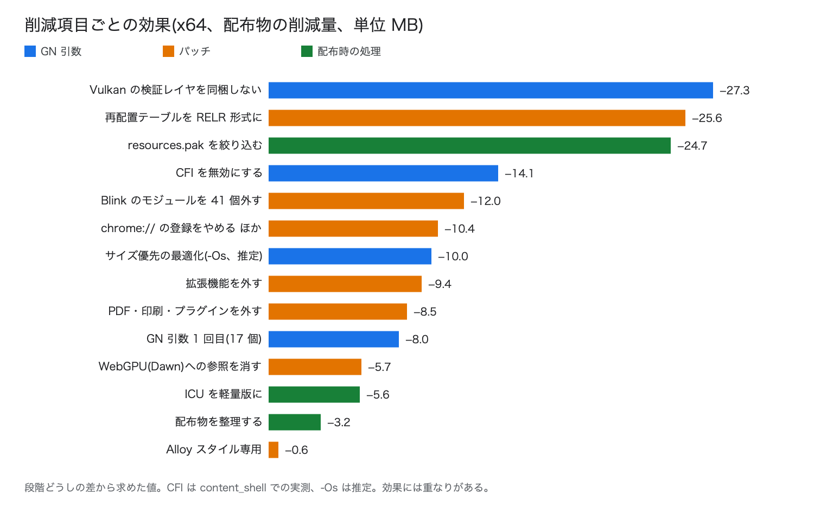

| 削減の内容 | 手段 | 効果 | 失うもの |
|---|---|---|---|
| Vulkan(GPU の API)の検証レイヤを同梱しない | GN 引数 `dawn_enable_vulkan_validation_layers=false` | −27.3MB | 開発用のデバッグ機能 |
| 再配置テーブルを RELR 形式にする | リンカオプション `-Wl,-z,pack-relative-relocs` を足すパッチ | −25.6MB | なし(実行環境に glibc 2.36 以降が必要) |
| `resources.pak` を絞り込む | 配布時の処理(`pakstrip.py`) | −24.7MB(25.6 → 0.9MB) | `chrome://` の全ページ、開発者ツール(DevTools)の画面、Chrome の初回起動の演出に使う音声 |
| CFI(関数呼び出しの不正な書き換えを検出する仕組み)を無効にする | GN 引数 `is_cfi=false` | 約 −14MB | 攻撃への耐性の一部。arm64 では既定で無効 |
| Blink のモジュールを 41 個外す | パッチ | −12.0MB | WebRTC、カメラとマイク、Bluetooth、USB、決済、通知、プッシュ通知、VR / AR、センサーなどの Web API |
| サイズ優先の最適化 | GN 引数 `optimize_for_size=true`(コンパイラの `-Os`) | 約 −10MB(推定) | 速度への影響は未計測 |
| `chrome://` のページの登録をやめる | パッチ(呼び出し 5 行の削除) | 約 −10MB(実行ファイル。GN 引数 17 個の追加と合わせた値) | `chrome://settings` などの全ページ |
| 拡張機能を外す | GN 引数 + パッチ | −9.6MB | `chrome.*` の拡張機能 API、`chrome-extension://` |
| PDF、印刷プレビュー、印刷、プラグインを外す | GN 引数 + パッチ | −8.5MB | PDF の表示、`window.print()`、CEF の PDF 出力 API |
| GN 引数で機能を外す(2 回、計 34 個) | GN 引数 | 実行ファイルで −8.0MB と約 −4MB | プリンタ(CUPS)、VR、リモート操作、機械学習の Web API、Kerberos 認証、Wayland(Linux の画面表示の仕組み)、GTK(Linux の UI 部品)、ハードウェア動画デコードの API(VA-API)など |
| WebGPU の実装(Dawn)への参照を消す | パッチ 3 行 | −5.7MB | なし(この環境では WebGPU はもともと無効) |
| ICU のデータを軽量版に差し替える | 配布時の処理 | −5.6MB(10.8 → 5.2MB) | 日本語の単語の区切りが 1 文字単位になる(ダブルクリックでの単語選択など) |
| 配布物を整理する | 配布時の処理 | −3.2MB | 高解像度画面用の画像、クラッシュレポートの送信 |
| Alloy スタイル専用にする | パッチ 4 ファイル | −0.6MB | Chrome スタイルのウィンドウ |

拡張機能、PDF、印刷、プラグインを外すパッチは、合わせて Chromium 側 342 ファイル、CEF 側 16 ファイル(Alloy スタイル専用の分を含む)です。「推定」と書いた値は、ほかの変更と同時に入れたため単独では測っていないものです。CFI の値は、同じ変更を `content_shell`(Chromium 159)に当てたときの実測です。効果には重なりがあるので、合計は全体の削減量と一致しません。

## 段階ごとのサイズ

実際に入れた順番と、その時点の配布物のサイズです(x64)。

| 段階 | 変更 | 配布物 | 前の段階との差 |
|---|---|---|---|
| CEF 既定 | | 377.5MB | |
| 手順 1 | GN 引数 17 個(Vulkan の検証レイヤなど) | 342.0MB | −35.5MB |
| 手順 2 | GN 引数 17 個(CFI 無効など) | 323.5MB | −18.5MB |
| 手順 3 | Blink のモジュールを 41 個外す | 311.5MB | −12.0MB |
| 手順 4 | RELR、Dawn への参照の削除 | 279.1MB | −32.4MB |
| 手順 5 | GN 引数 17 個、`chrome://` のページの登録をやめる、`resources.pak` の絞り込み | 245.2MB | −33.9MB |
| 手順 6 | Alloy スタイル専用 | 244.6MB | −0.6MB |
| 手順 7 | PDF と印刷とプラグインを外す、`-Os`、`resources.pak` を最小に | 225.0MB | −19.6MB |
| 手順 8 | 拡張機能を外す | 215.4MB | −9.6MB |
| 手順 9(削減版) | 配布物の整理、ICU の軽量版 | 206.6MB | −8.8MB |

手順 8 までの変更は、ビルド結果を全部消してからのビルド(クリーンビルド、51,361 ステップ、128 分)でも同じサイズになりました。

## GN 引数で外す

最初の手段は GN 引数です。ただし //chrome 層の主な機能(PDF、印刷、拡張機能など)は、GN 引数を false にしただけではビルドが通りません。//chrome や CEF のコードに「この機能は必須」という検査(`assert`)や、条件なしの依存があるためです。また、GN の設定生成(`gn gen`)が通っても、コンパイル、起動、動作確認で失敗する引数がありました(例: `enable_chrome_notifications=false` は起動時の内部検査で落ちる)。最終的な設定は、リポジトリの `args/F4b.args.gn`(x64)と `args/G2.args.gn`(arm64)にあります。

## RELR 形式の再配置

共有ライブラリには、読み込まれたアドレスに合わせて書き換える場所の一覧(再配置テーブル)があります。`libcef.so` では、この一覧(`.rela.dyn`)が 25.8MB ありました。RELR は、この一覧を詰めて持つ形式です。手順 4 で `.rela.dyn` の 25.8MB が `.relr.dyn` の 0.2MB になりました。Chromium の Linux 向けビルドにはこの設定がないので、GN 引数を足すパッチを書きました。

```diff:build/config/compiler/BUILD.gn
+declare_args() {
+  fp_use_relr_relocations = false
+}
@@ config("linker") {
+  if (fp_use_relr_relocations && is_linux && use_lld) {
+    ldflags += [ "-Wl,-z,pack-relative-relocs" ]
+  }
```

リンカオプションは `-z pack-relative-relocs` を使います。似た `--pack-dyn-relocs=relr` では、出力に glibc 向けの印(`GLIBC_ABI_DT_RELR`)が付かず、ビルドの途中で作るツール(`protoc`)が起動しません。

## 一括登録の呼び出しを消す(`chrome://` のページ)

`chrome://settings` などの、ブラウザが内蔵している Web ページ(WebUI)は、`chrome_browser_main.cc` の 2 つの関数でまとめて登録されています。この呼び出しを消すと、各ページのコードがどこからも参照されなくなり、リンカが取り除きます。

```diff:chrome/browser/chrome_browser_main.cc
-  RegisterChromeWebUIConfigs();
-  RegisterChromeUntrustedWebUIConfigs();
+  // FP: chrome:// の WebUI は登録しない(TV 向け最小構成)。
```

同じ考え方で、これらのページとブラウザの間の通信(Chromium のプロセス間通信 Mojo)の登録 3 か所も消しました。ページの HTML や画像は `resources.pak` に残るので、許可したリソースだけで pak を作り直すスクリプト `pakstrip.py` を合わせて使いました。`resources.pak` の 25.6MB のうち 4.8MB は、Chrome の初回起動の演出に使う音声(FLAC 6 本)でした。

## Blink のモジュールを外す

Blink の Web API はモジュール単位で分かれています。`third_party/blink/renderer/modules/BUILD.gn` の依存からモジュールを外し、それを参照している箇所を消すパッチ(46 ファイル)を書きました。

```diff:third_party/blink/renderer/modules/BUILD.gn
     "//third_party/blink/renderer/modules/accessibility",
     "//third_party/blink/renderer/modules/ad_auction",
-    "//third_party/blink/renderer/modules/ai",
     "//third_party/blink/renderer/modules/animationworklet",
-    "//third_party/blink/renderer/modules/app_banner",
     "//third_party/blink/renderer/modules/audio_output_devices",
-    "//third_party/blink/renderer/modules/background_fetch",
-    "//third_party/blink/renderer/modules/background_sync",
```

外したモジュールの関数を呼んでいる箇所のために、空の実装を置くファイル(`fp_stubs.cc`)も追加しました。

## PDF、印刷、拡張機能を外す

この 3 つには GN 引数(`enable_pdf`、`enable_printing`、`enable_extensions` など)がありますが、false にすると //chrome と CEF のコードがコンパイルできなくなります。参照している箇所を条件コンパイル(`#if BUILDFLAG(...)`)で囲むパッチを書きました。拡張機能は参照箇所が多く、Chromium 側で 342 ファイルを変更しています(PDF と印刷の分を含む)。

x64 では、拡張機能を外すと起動直後の回収できない RAM も 40MiB 減りました。手順 7 の段階では、内蔵の拡張機能(Service Worker)のためにレンダラプロセスが 1 つ常駐していて(PSS 約 45MiB)、拡張機能を外すとこのプロセスが起動しなくなったためです。

## arm64

x64 用のパッチと GN 引数は、`target_cpu="arm64"` を足すだけで arm64 にもそのまま通りました。arm64 の削減版の実行ファイルは x64 より 4.5MB 小さく、配布物は 13.0MB 大きくなりました。差のほとんどは SwiftShader です。SwiftShader は、arm64 では軽量のコード生成器(Subzero)を使えず、汎用のコンパイラ基盤 LLVM 10 を丸ごとリンクします(`third_party/swiftshader/src/Reactor/reactor.gni:13`)。そのため `libvk_swiftshader.so` は、x64 の 5.4MB に対して 22.8MB(strip 前)になります。GPU のある機器では SwiftShader は要らないので、一式を配布物から外した場合も測りました(−23.6MB)。

arm64 版では、YouTube の TV 向けアプリ Cobalt のビルド設定から 4 つの GN 引数(`enable_media_remoting`、`enable_media_remoting_rpc`、`enable_hls_demuxer`、`enable_hevc_parser_and_hw_decoder` をすべて false)も採り入れました。効果は −0.5MB でした。

## 削れなかったもの

//chrome 層と CEF 本体は、削減版でも約 45〜55MB 残っています。2 通りの方法で見積もりました。

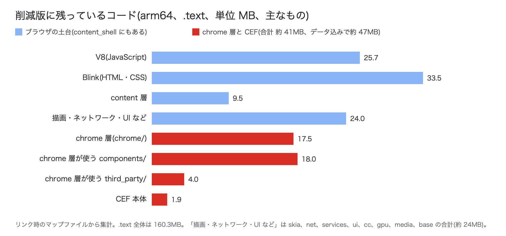

| 方法 | 見積もり |
|---|---|
| リンク時に出力したマップファイル(どのソースのコードが何バイト入ったかの一覧)で、`chrome/`(17.5MB)、CEF 本体(1.9MB)、//chrome から使われる `components/`(約 18MB)と `third_party/`(約 4MB)を積み上げる(arm64 の削減版) | 約 47MB(積み上げた `.text` は約 41MB。読み取り専用データなどを同じ割合で足した) |
| 同じ削減を入れた `content_shell`(Chromium 159、x64、160.4MB)に、RELR(実測 −12.8MB)と `-Os`(推定 約 −10MB)を当てた見込み(約 138MB)と、x64 の削減版の実行ファイル(191.2MB)の差 | 約 53MB(推定) |

残っているのは、自動入力(`components/autofill` だけで 3.1MB)、パスワード管理、同期、アドレスバーの補完、危険なサイトの警告(Safe Browsing)、企業向けのポリシー、履歴、Chrome スタイルの UI などです。外せなかった理由は次のとおりです。

- CEF は //chrome のクラスを継承して動くので、//chrome 層そのものは外せない
- これらの機能は、//chrome の中央の登録箇所(プロファイルごとのサービスの一括登録など)から直接参照されている。機能ごとの GN 引数がなく、個々の参照を消すパッチでは別の参照が残ってリンクされる
- Alloy スタイル専用にしても −0.6MB だった。Chrome スタイルの UI のクラスは、生成する箇所以外にも数千か所から参照されている

比較として、同じ Chromium で `chrome` を `content_shell` に替えると、実行ファイルは 309.8MB から 211.9MB(−97.9MB。どちらも削減なし)になりました。CEF は //chrome 層を前提に作られているので、この方法を使えません。

# RAM の削り方

## 起動直後

起動直後の RAM(arm64、テストページを開いて 30 秒後):

| 構成 | プロセス数 | PSS(A + B) | A: 回収できない分のうちプロセスが触ったページ | B: ファイル由来の RAM | 回収できない RAM(cgroup) | CEF 本体の PSS |
|---|---|---|---|---|---|---|
| CEF 既定 | 8 | 387.6MiB | 159.2MiB | 228.7MiB | 160.5MiB | 239.3MiB |
| 削減版 | 8 | 286.7MiB | 127.5MiB | 159.4MiB | 128.8MiB | 173.9MiB |
| 削減版、SwiftShader なし | 8 | 234.7MiB | 93.8MiB | 141.0MiB | 101.8MiB | 168.8MiB |

x64 での段階ごとの測定では、手順 3 から手順 7 までで実行ファイルを 61MB 減らしても、回収できない RAM は −8MiB でした。この区間で減ったのは主にファイル由来の RAM です(RELR で約 −24.5MiB)。続く手順 8(拡張機能を外す)では、回収できない RAM が −40MiB 減りました。

## プロセスの数を減らす起動フラグ

3 フラグの `--single-process` は、レンダラのプロセス分離とサンドボックスを手放します。レンダラを別プロセスのまま残し、ほかのプロセスだけをブラウザプロセスにまとめる次の 3 つの起動フラグも試しました。以降まとめて「プロセス削減フラグ」と呼びます。

| 起動フラグ | 内容 |
|---|---|
| `--in-process-gpu` | GPU の処理をブラウザプロセスのスレッドで動かす |
| `--no-unsandboxed-zygote` | サンドボックスなしの zygote を起動しない(GPU プロセスは通常この zygote から作られるので、`--in-process-gpu` と組み合わせる) |
| `--enable-features=NetworkServiceInProcess2` | ネットワークサービスをブラウザプロセスのスレッドで動かす |

起動直後の RAM(3 回の中央値):

| 起動フラグ | プロセス | 構成 | PSS(A + B) | A: 回収できない分のうちプロセスが触ったページ | B: ファイル由来の RAM | 回収できない RAM(cgroup) |
|---|---|---|---|---|---|---|
| なし | 8 | CEF 既定 | 387.6MiB | 159.2MiB | 228.7MiB | 160.5MiB |
| なし | 8 | 削減版、SwiftShader なし | 235.3MiB | 93.7MiB | 141.4MiB | 102.1MiB |
| プロセス削減フラグ | 5 | CEF 既定 | 289.1MiB | 80.2MiB | 208.9MiB | 88.0MiB |
| プロセス削減フラグ | 5 | 削減版、SwiftShader なし | 208.8MiB | 68.0MiB | 140.7MiB | 76.0MiB |
| 3 フラグ | 1 | CEF 既定 | 266.1MiB | 58.0MiB | 208.2MiB | 65.7MiB |
| 3 フラグ | 1 | 削減版、SwiftShader なし | 188.5MiB | 48.8MiB | 139.7MiB | 56.7MiB |

- CEF 既定でも、プロセス削減フラグで回収できない RAM は 160.5 から 88.0MiB に、PSS は 387.6 から 289.1MiB に減りました(動作確認 7/7)。プロセスの数を減らす効果は、ROM の削減とは別に効きます
- 残るプロセスは、ブラウザ、サンドボックスありの zygote、ストレージ、レンダラ 2 つの 5 つです。レンダラのサンドボックスは残り、レンダラが落ちてもそのタブだけで済みます
- GPU とネットワークサービスはブラウザプロセスの中で動くので、GPU の初期化に失敗したときの切り替えはできません(「実機で GPU を使う場合」)
- プロセス削減フラグと 3 フラグの行は、GPU デバイスがないので `--disable-gpu` を付けて測りました。3 フラグには低メモリ端末モードが入っていますが、プロセス削減フラグには入っていないので、差のすべてがプロセスの数によるものではありません。再生中の RAM は測っていません
- 削減版の値は、UPX 用の 2 つの変更を入れた圧縮前のもので、削減版、SwiftShader なしと同じです(起動直後の cgroup 101.8MiB と 102.1MiB)

## 動画の再生中

AV1 1080p60 を再生しているときの値です(arm64、8 CPU / 8GB、PSS、最後まで再生できた 3 回の中央値)。この表の削減版は、arm64 版の最後の 2 つの変更(Cobalt 由来の GN 引数 4 個と配布物の整理)を入れる前の段階で測りました。

| 構成 | 低メモリ端末モード | 再生中の PSS | レンダラプロセス | GPU プロセス | 動画の先読み量 |
|---|---|---|---|---|---|
| CEF 既定 | オフ | 1,060.7MiB | 523.2MiB | 279.3MiB | 170.6 秒分 |
| CEF 既定 | オン | 1,008.3MiB | 498.3MiB | 242.6MiB | 70.1 秒分 |
| 削減版 | オフ | 907.4MiB | 488.6MiB | 236.9MiB | 170.6 秒分 |
| 削減版 | オン | 883.6MiB | 482.7MiB | 208.0MiB | 70.2 秒分 |

動画の先読み量は、MSE でブラウザが保持している動画データの秒数です。

項目ごとの効果は次のとおりでした。

| 項目 | 効果 | 内容 |
|---|---|---|
| ROM の削減 | −153MiB(−14.5%) | 主な内訳はファイル由来 −75MiB、プログラムが確保したメモリ −83MiB(共有メモリなどの増減があるので、合計は一致しない) |
| 低メモリ端末モード | −24〜−52MiB | 動画の先読みが 170 秒分から 70 秒分に、JavaScript のメモリ上限が 4,132MiB から 259MiB になる |
| `--single-process --no-zygote` | −34MiB | 全部を 1 プロセスにまとめ、プロセスごとに必要な分がなくなる(低メモリ端末モードを含むフラグ一式に足したときの差) |
| CPU 数(2 → 16) | +39MiB | CPU 数に合わせてスレッドが増える |
| 搭載メモリ量(2GB〜8GB) | ほぼ変わらない | |

低メモリ端末モードは、搭載メモリが 2048MB 以下だと自動で有効になります(Linux の既定)。2GB を割り当てたコンテナはカーネルが報告するメモリ量(MemTotal)が 2,101MiB で、自動では有効になりませんでした。1.9GB(MemTotal 1,959MiB)では自動で有効になりました。

`--single-process` を使うと、ページの処理が落ちたときにブラウザごと落ち、プロセスを分けて守る仕組み(サンドボックス)もなくなります。

## 4K と 1080p の差

AV1 4K60 は H.264 1080p60 より +320〜460MiB 多く必要でした。増えた分のほとんどは、デコード済みのフレームと動画の先読みのデータです(Chromium のメモリ計測機能 memory-infra で見たメディア関連のメモリが、1080p の約 134〜140MiB から 4K の約 410〜540MiB)。1080p どうしでは、AV1 と H.264 で RAM の差はほとんどありませんでした(CEF 既定で −15MiB)。

## メモリの上限をかけたとき

Chromium は cgroup の上限を見ていません。上限に近づいても自分からメモリを手放さず、カーネルがファイル由来のページを捨て、それでも足りなければブラウザを強制終了します。そのため上限を変えても動作は変わらず、再生できるかどうかだけが変わります。

上限に数えられるのは、回収できない RAM のほかに、捨てきれないファイル由来のページ(約 100〜130MiB)とカーネルの分(約 10MiB)です。制限なしで測った回収できない RAM の最大値に約 100MiB を足した上限では、CEF 既定(H.264 1080p、780MiB)が読み込み中に強制終了されました。約 200MiB を足した上限では、どの条件でも再生できました。

## SwiftShader がなくても描画できる理由

Chromium には、画面を作る道が 2 本あります。GPU を使う道と、最初から CPU だけで済ませる道です。SwiftShader は、GPU を使う道を GPU のない機器でも通すための「GPU のふりをする CPU のプログラム」です。SwiftShader も GPU もないと、Chromium は CPU だけの道に切り替えます。CPU だけの道はもともと GPU の命令を使わないので、SwiftShader がなくても画面を描けます。

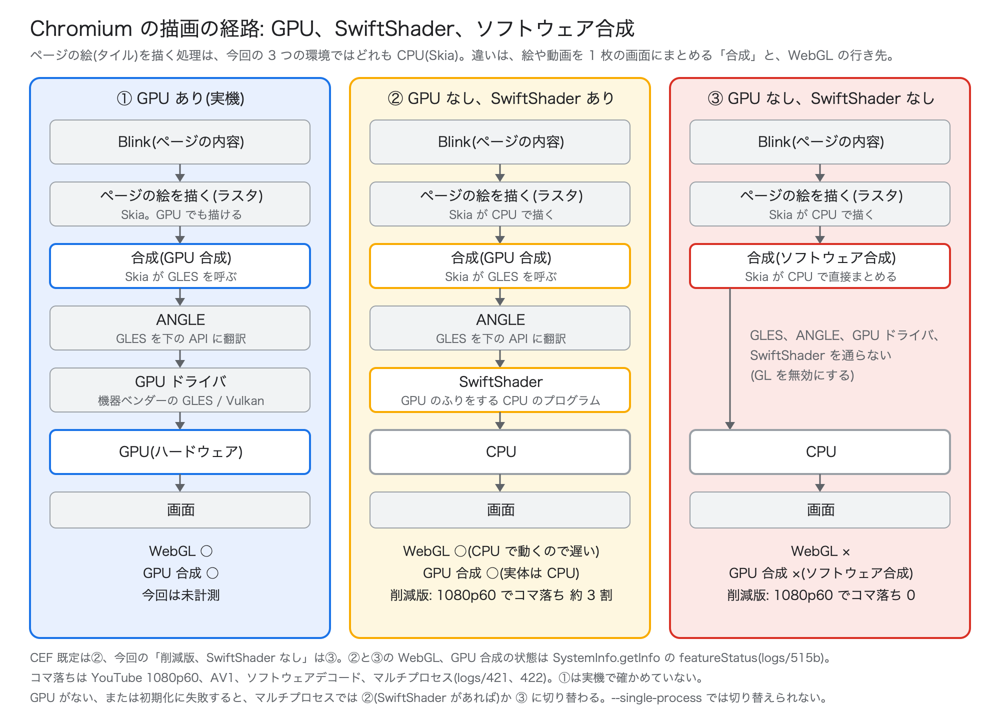

図に出てくる部品は次のとおりです。

| 部品 | 役割 |
|---|---|
| Skia | Chromium の 2D 描画ライブラリ。図形や文字を、CPU でも GPU(GLES 経由)でも描ける |
| 合成 | ページの絵(タイル)、動画、スクロールする層などを 1 枚の画面にまとめる処理 |
| GLES(OpenGL ES) | GPU に絵を描かせるための標準の命令セット(API)。Chromium の GPU の処理は GLES で書かれている |
| ANGLE | GLES の命令を、その機器で使える API(GPU ドライバの OpenGL ES や Vulkan など)に翻訳する。`libcef.so` に入っている |
| GPU ドライバ | 機器ベンダーが提供する、GPU を動かすソフトウェア |
| SwiftShader | GPU の API(Vulkan)を CPU で実装したもの。ANGLE からは GPU ドライバと同じに見える。CEF は `libvk_swiftshader.so` などの一式を同梱している |

計測環境(GPU なし)で、SwiftShader のある削減版(図の②)とない削減版(図の③)の GPU の機能の状態を、DevTools プロトコルの `SystemInfo.getInfo` で比べました。

| 機能 | ② SwiftShader あり | ③ SwiftShader なし |
|---|---|---|
| GL(`opengl`) | 有効 | 無効 |
| GPU 合成(`gpu_compositing`) | 有効(SwiftShader の上) | ソフトウェア合成 |
| WebGL(`webgl`) | 有効 | 無効 |
| 2D の canvas(`2d_canvas`) | 有効 | ソフトウェア |
| ページの絵を描く処理(`rasterization`) | ソフトウェア | ソフトウェア |
| 動画のデコード(`video_decode`) | ソフトウェア | ソフトウェア |
| GPU として見えるもの | SwiftShader(Vulkan 1.3) | なし |

②でも、ページの絵と動画のデコードは CPU で処理していて、SwiftShader が受け持つのは合成と WebGL、2D の canvas だけです。③では、この 3 つも CPU の道に移ります。2D の canvas は CPU で描かれて表示され、WebGL だけが使えなくなります。

部品がなくなったときに起きることは次のとおりです。

| 状態 | 起きること |
|---|---|
| GPU あり、SwiftShader なし | 図の①。SwiftShader はもともと使われない |
| GPU なし、SwiftShader あり | 図の②。WebGL も動くが、GPU の処理を CPU で模擬するので重い。削減版の YouTube 1080p60 で、コマ落ちは約 3 割だった(③では 0) |
| GPU なし、SwiftShader なし(マルチプロセス) | GPU プロセスが GL の初期化に失敗して終了する。ブラウザは GL を無効にして GPU プロセスを起動し直し、図の③になる |
| GPU なし、SwiftShader なし(`--single-process`) | GPU の処理がブラウザの中にあるので起動し直せない。SwiftShader を使う起動フラグを付けていると落ちた。`--disable-gpu` を付けると、最初から図の③で動く(次の節) |
| GPU あり、ドライバの初期化に失敗 | マルチプロセスなら②(SwiftShader があれば)か③に切り替わる。`--single-process` や `--in-process-gpu` では落ちる(「実機で GPU を使う場合」) |

②が③より重い理由は確かめていません。SwiftShader は GPU の処理の手順(シェーダの実行など)を CPU で再現するので、Skia が CPU で直接まとめる③より手間が多いためと考えられます。

## SwiftShader なしで `--single-process` を使う条件

SwiftShader を外した削減版は、計測ツールが付けていた SwiftShader 用の起動フラグ(`--use-gl=angle --use-angle=swiftshader --enable-unsafe-swiftshader`)と `--single-process` を一緒に使うと、起動直後に落ちました。

- 通常のマルチプロセスでは、GPU プロセスが初期化に失敗すると、ブラウザが GPU を使わない描画方式に切り替えて GPU プロセスを作り直す
- `--single-process` では GPU の処理はスレッドなので作り直せない。描画方式は起動時に SwiftShader を使う方式に決まり、初期化に失敗したまま描画の準備(`gl::init::CreateGLContext`)が呼ばれて落ちる(デバッガ gdb でスタックを確認)

SwiftShader 用の 3 つのフラグを付けずに `--disable-gpu` を付けると起動し、YouTube も再生できました。ビルドの変更は要りません。

## 実機で GPU を使う場合

計測には GPU デバイスがないので、`--single-process` では `--disable-gpu` を付けました。実機では GPU で描画したいので、Chromium 158.0.8127.18 のソースで、GPU をブラウザプロセスの中で動かすときの初期化の流れを確認しました。`--single-process` と `--in-process-gpu` は、どちらもこの流れになります。

| 場所 | 内容 |
|---|---|
| `content/gpu/in_process_gpu_thread.cc:102` | GPU のスレッドは `GpuInit::InitializeInProcess()` で初期化する |
| `gpu/ipc/service/gpu_init.cc:1086〜1163` | `InitializeInProcess()` は最初に初期化成功の印を立て、GL の初期化に失敗するとログを出して戻るだけで、ブラウザに失敗を伝えない |
| `content/browser/gpu/gpu_data_manager_impl_private.cc:455、1635` | 描画方式の切り替え(ハードウェア GL → SwiftShader → GPU なし)は、GPU プロセスを起動し直して行う。プロセス内の GPU では起動し直せないので、起動時に決めた方式から変わらない |
| `gpu/config/gpu_util.cc:973〜1002` | GPU がブロックリスト(動作に問題がある GPU やドライバの一覧)に当たって GL や WebGL の機能が無効になると、SwiftShader に切り替える。`--disable-software-rasterizer` を付けるか、`--use-gl` で GL の実装を明示すると切り替えない |
| `ui/ozone/platform/x11/x11_surface_factory.cc:178` ほか | 使える GL の実装は、画面の出力方式(Ozone のプラットフォーム)で決まる。X11 は ANGLE、Wayland は ANGLE の OpenGL / OpenGL ES / SwiftShader / Vulkan、DRM/KMS(ウィンドウシステムを使わず、Linux カーネルの画面出力機能で直接表示する方式)は ANGLE と SwiftShader |
| `ui/gl/features.gni:10` | `use_static_angle = true`。ANGLE は `libcef.so` に入っている |

このことから、実機で GPU を使うときの対策として次のものが考えられます。どれも実機では試していません。

1. **GL の実装を明示する**: `--use-gl=angle --use-angle=gles` で、ANGLE を機器の OpenGL ES ドライバの上で動かす。`--use-gl` を明示すると、ブロックリストに当たっても SwiftShader に切り替えない(`gpu_util.cc:987`)。SwiftShader を外した配布物では、切り替わると初期化に失敗して落ちるので、これが要る
2. **ブロックリストを確かめる**: 機器の GPU がブロックリストに当たると、GPU の機能が無効になる。`--ignore-gpu-blocklist` で無視できるが、ブロックリストは不具合の回避のためにあるので、機器のドライバで描画と動画を確かめてから使う。今回の削減版は `chrome://gpu` のページを外しているので、GPU の状態は DevTools プロトコルの `SystemInfo.getInfo` で見る
3. **Ozone のプラットフォームを機器に合わせる**: 今回のビルドは X11 だけで、`ozone_platform_wayland=false` にしている。Wayland や DRM の機器では、GN 引数で該当するプラットフォームを有効にしてビルドし直す
4. **GPU の初期化に失敗したときの逃げ道を残す**: プロセス内の GPU は、ドライバの初期化に失敗するとブラウザごと落ちる。GPU を別プロセスにしておけば、失敗しても GPU なしの描画に切り替わる。後述の UPX を使う場合、GPU プロセスはサンドボックスなしの zygote から fork されるので、GPU プロセス自体は展開コピーを増やさない。ただし、その zygote の分の 1 コピー(約 153MiB)が要る。プロセス削減フラグから `--in-process-gpu` と `--no-unsandboxed-zygote` を外す形になり、コピーは 2 個から 3 個になる。プロセス内の GPU のまま逃げ道を作るには、`InitializeInProcess()` で GL の初期化に失敗したときに GL を無効の扱いにして、ブラウザに GPU なしの描画を選ばせる変更が要る(パッチは書いていない)

GPU を使うと、GPU のドライバ(機器ベンダーの `libEGL`、`libGLESv2` など)が読み込まれます。これらはシステムのライブラリで、後述の UPX で圧縮する対象ではないので、ファイル由来の RAM として共有され、回収もできます。ハードウェアの動画デコーダも GPU の処理の中で動きます(`in_process_gpu_thread.cc:105` の VA-API の初期化など)。ARM の SoC で使われる V4L2(Linux の動画デコーダなどを扱う標準のインターフェース)のデコーダを有効にするビルドは確かめていません。

# UPX で圧縮する

UPX は、実行ファイルを圧縮しておき、起動時にメモリ上で展開するツールです。https://qiita.com/rairaii/items/d5a5c3da56dbc7063a19 (以下、参考記事)では、Chromium の実行ファイルを UPX で圧縮すると、ROM は約 190MiB 減る一方で、回収できない RAM が増えることを確かめています。CEF ではコードのほとんどが共有ライブラリ `libcef.so` にあるので、`libcef.so` を圧縮して同じことを確かめました。対象は ROM が最も小さい、arm64 の削減版(SwiftShader なし)です。

## ROM


| ファイル | CEF 既定 | 削減版 | 削減版 + UPX |
|---|---|---|---|
| `libcef.so` | 275.1MB(`cefsimple` を含む) | 186.2MB | 86.0MB |
| `cefsimple` | (上に含む) | 0.6MB | 0.1MB |
| そのほか(`.pak`、ICU のデータ、V8 の起動用データ、`libEGL.so` など、ロケール) | 91.2MB | 9.2MB | 9.2MB |
| 配布物の合計 | 366.3MB | 196.0MB(−46.5%) | 95.3MB(−74.0%) |

括弧内は CEF 既定との比較です。UPX が縮めるのは実行コードを含む 2 ファイルだけで、削減版から UPX でさらに −51.4% になります。CEF 既定の `libcef.so` にも UPX をかけられる見込みですが(次の節の 2 つの確認が要る)、試していません。

## `libcef.so` を UPX で圧縮する手順

Chromium のリンカ(lld)で作った `libcef.so` は、そのまま UPX で圧縮すると、読み込んだ時点でセグメンテーション違反になります。UPX 4.2.2、5.0.2、5.3.0(調査時点の最新)のどれでも同じでした。次の 2 つを満たすように作り直すと、UPX 5.3.0 の既定のオプションで圧縮して起動し、動作確認の 7 項目もすべて通りました。2 つとも、圧縮前の `libcef.so` を `readelf` で見れば当てはまるかどうかが分かります。

| 確認すること | 確認の方法 | 削減版での結果 | 対処 |
|---|---|---|---|
| 読み取り専用データが実行コードと別のセグメント(プログラムを読み込む単位。`R` は読み取り、`E` は実行、`W` は書き込みの権限)になっていないか | `readelf -lW libcef.so` の `LOAD` 行 | 権限が `R`、`R E`、`RW`、`RW` の 4 つ。lld は既定で読み取り専用データを別のセグメントに置く(`--rosegment`) | リンカオプション `-Wl,--no-rosegment` を付けてリンクし直す。`R E`、`RW`、`RW` の 3 つになる |
| IFUNC がないか | `readelf -rW libcef.so \| grep -c IRELATIVE` | 3 | IFUNC を普通の関数に置き換える。0 になる |

IFUNC は、実行時に CPU の機能を見て関数の実装を選ぶ仕組みです。動的リンカは、ライブラリを読み込む途中で IFUNC の選択関数を呼びます。圧縮した `libcef.so` では、この時点でまだ UPX がコードを展開していないので、展開前のデータを実行して落ちます。`libcef.so` の IFUNC は、メモリアロケータ PartitionAlloc の、ARM のメモリタグ機能(MTE)用の 3 つでした。初回の呼び出し時に同じ選択関数を呼んで結果を覚える普通の関数に置き換えるパッチ(`patches/chromium/upx-noifunc.patch`、2 ファイル)を書きました。MTE の有無で実装を選ぶ動作は変わりません。

どちらの変更も、それだけではサイズも RAM も変わりません(起動直後の回収できない RAM は 101.8MiB と 102.1MiB)。リンクのやり直しとパッチの再ビルドは、どちらも約 2 分でした。調査では `out/<構成>/obj/cef/libcef.ninja` のリンカオプションを手で書き換えたので、`gn gen` をやり直すと元に戻ります。

圧縮は `strip` のあとに行います。`strip` 前の `libcef.so`(375MB)を圧縮すると、デバッグ情報まで圧縮して展開することになります。ANGLE は `libcef.so` に静的にリンクされていて、配布物の `libEGL.so` と `libGLESv2.so` は 0.3MB ずつしかないので、圧縮する意味はありません(圧縮するなら同じ 2 つの確認が要ります。`libEGL.so` も `--rosegment` のままでは落ちた)。

### 起動しないときの切り分け

| 症状 | 見るところ | 原因 |
|---|---|---|
| `libcef.so` を読み込んだ直後に落ち、gdb のスタックにシンボルがない(UPX の展開処理の中) | `readelf -lW` の `LOAD` 行 | セグメントの分け方 |
| gdb のスタックに `Resolve…` のような IFUNC の選択関数が出る | `readelf -rW` の `IRELATIVE` | IFUNC |
| 実行ファイル(`cefsimple`)だけ圧縮すると起動する | — | 共有ライブラリ側の問題。上の 2 つを確認する |

次のものは関係しません(切り分けで確かめた)。

- 再配置テーブルの RELR 形式: RELR のない `libEGL.so` も落ち、RELR のまま上の 2 つを直すと動いた
- UPX の版: 4.2.2、5.0.2、5.3.0 で同じ
- UPX の `--android-shlib` オプション: 付けても落ちた

Ubuntu のシステムのライブラリ(GNU ld でリンク)は、同じ UPX で圧縮しても読み込めました。GNU ld は既定で読み取り専用データと実行コードを同じセグメントに置くので、上の確認の 1 つ目に当てはまりません。

## RAM

起動直後(テストページを開いて 30 秒後、3 回の中央値):

| 起動フラグ | 構成 | PSS(A + B) | A: 回収できない分のうちプロセスが触ったページ | B: ファイル由来の RAM | 回収できない RAM(cgroup) |
|---|---|---|---|---|---|
| なし | CEF 既定 | 387.6MiB | 159.2MiB | 228.7MiB | 160.5MiB |
| なし | 圧縮前 | 235.3MiB | 93.7MiB | 141.4MiB | 102.1MiB |
| なし | UPX | 336.5MiB(+101) | 309.4MiB(+216) | 27.1MiB | 715.4MiB(+613) |
| 3 フラグ | CEF 既定 | 266.1MiB | 58.0MiB | 208.2MiB | 65.7MiB |
| 3 フラグ | 圧縮前 | 188.5MiB | 48.8MiB | 139.7MiB | 56.7MiB |
| 3 フラグ | UPX | 188.5MiB(±0) | 162.9MiB(+114) | 25.6MiB | 210.0MiB(+153) |

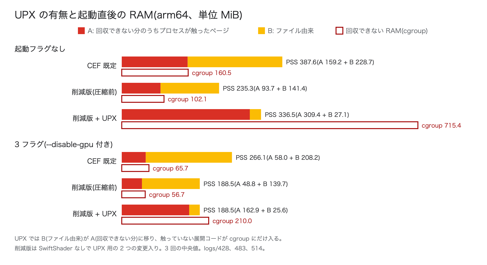

「圧縮前」と「UPX」は削減版(SwiftShader なし、UPX 用の 2 つの変更入り)で、括弧内は圧縮前との差です。CEF 既定の 3 フラグは、削減版と同じく `--disable-gpu` を付けました。

H.264 1080p の再生中(最後まで再生できた 2 回の中央値):

| 起動フラグ | 構成 | PSS(A + B) | A: 回収できない分のうちプロセスが触ったページ | B: ファイル由来の RAM | 回収できない RAM(cgroup) |
|---|---|---|---|---|---|
| なし | CEF 既定 | 1,045.5MiB | 789.8MiB | 255.8MiB | 790.0MiB |
| なし | 圧縮前 | 757.7MiB | 590.3MiB | 167.3MiB | 598.3MiB |
| なし | UPX | 887.6MiB(+130) | 855.0MiB(+265) | 32.5MiB | 1,366.2MiB(+768) |
| 3 フラグ | CEF 既定 | 912.2MiB | 660.7MiB | 251.4MiB | 661.9MiB |
| 3 フラグ | 圧縮前 | 694.0MiB | 528.9MiB | 165.2MiB | 537.7MiB |
| 3 フラグ | UPX | 681.5MiB(−12.5) | 649.6MiB(+121) | 31.9MiB | 679.0MiB(+141) |


CEF 既定の値は「結果」の節と同じ測定です(CEF 既定は SwiftShader で描画、削減版の 3 フラグは `--disable-gpu`)。

### CEF 既定と比べると

削減版 + UPX を 3 フラグで動かした場合を、CEF 既定、および UPX をかける前の削減版と比べました。削減版は、UPX 用の 2 つの変更を入れた圧縮前のものです。

| 項目 | CEF 既定、起動フラグなし | CEF 既定、3 フラグ | 削減版、3 フラグ | 削減版 + UPX、3 フラグ |
|---|---|---|---|---|
| ROM(配布物) | 366.3MB | 366.3MB | 196.0MB | 95.3MB |
| 起動直後の PSS(A + B) | 387.6MiB | 266.1MiB | 188.5MiB | 188.5MiB |
| 起動直後の A | 159.2MiB | 58.0MiB | 48.8MiB | 162.9MiB |
| 起動直後の B | 228.7MiB | 208.2MiB | 139.7MiB | 25.6MiB |
| 起動直後の回収できない RAM(cgroup) | 160.5MiB | 65.7MiB | 56.7MiB | 210.0MiB |
| 再生中の PSS(A + B) | 1,045.5MiB | 912.2MiB | 694.0MiB | 681.5MiB |
| 再生中の A | 789.8MiB | 660.7MiB | 528.9MiB | 649.6MiB |
| 再生中の B | 255.8MiB | 251.4MiB | 165.2MiB | 31.9MiB |
| 再生中の回収できない RAM(cgroup) | 790.0MiB | 661.9MiB | 537.7MiB | 679.0MiB |
| 再生中の cgroup + B | 1,045.8MiB | 913.3MiB | 702.9MiB | 710.9MiB |

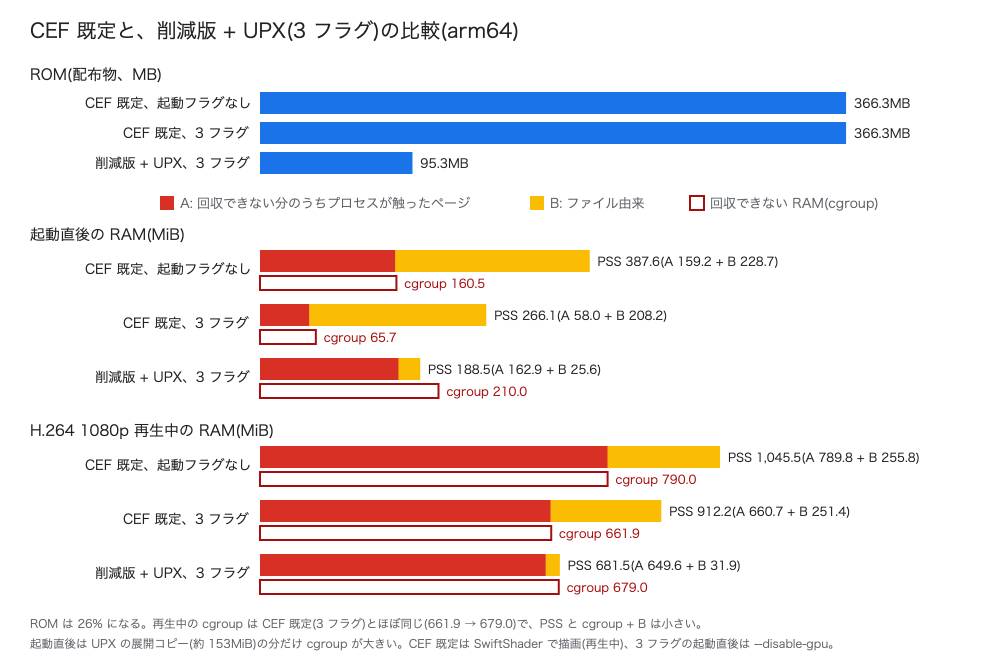

CEF 既定を同じ 3 フラグで動かした場合と比べても、再生中の回収できない RAM(cgroup)は +17MiB で、ほぼ同じです。プロセスが触ったページ(A)では −11MiB、PSS では −231MiB です。3 フラグで並べると、再生中の回収できない RAM は、ROM の削減で 661.9 → 537.7MiB(−124)に減り、UPX で 679.0MiB(+141)に戻ります。UPX で増える分を、ROM の削減で減った分がほぼ打ち消しています。起動直後は動画のバッファなどがなく、UPX の展開コピー(約 153MiB)の割合が大きいので、+144MiB の差が残ります。GPU の条件は、起動直後の 3 フラグはどれも `--disable-gpu`、再生中は CEF 既定が SwiftShader、削減版と削減版 + UPX が `--disable-gpu` です。再生中の CEF 既定と削減版では条件が違うので、差のすべてが ROM の削減と UPX によるものではありません。

## 回収できない RAM が増える仕組み

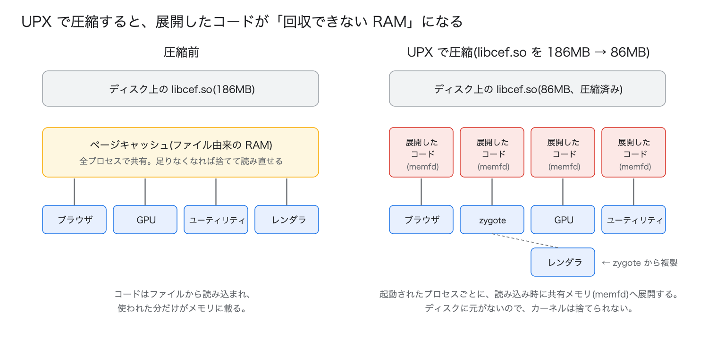

圧縮前は、`libcef.so` のコードはファイルから読み込まれたページ(ファイル由来の RAM)で、全プロセスで共有され、メモリが足りなくなればカーネルが捨てて読み直せます。UPX で圧縮すると、`libcef.so` を読み込むときに、展開したコードを共有メモリ(memfd)に置きます。ディスクに元のデータがないので、カーネルはこのメモリを捨てられません。

PSS で見ると、3 フラグでは起動直後が 188.5MiB で圧縮前と同じ、再生中は圧縮前より 12.5MiB 少ない値でした。表の A と B を見ると理由が分かります。

- プロセスが触るコードのページは、圧縮前でも UPX でも同じ。UPX ではその置き場所がファイル(B)から memfd(A)に移るだけなので、PSS の合計はほとんど変わらない。3 フラグの起動直後では、B が 114.1MiB 減り、A が 114.1MiB 増えた
- memfd には、展開したコード全体(約 153MiB)が置かれ、cgroup にはその全部が課金される。プロセスが触っていないページはどのプロセスの PSS にも入らないので、cgroup の値と A の差が広がる。3 フラグの起動直後では、この差が 7.9MiB(圧縮前)から 47.1MiB(UPX)になった

PSS が回収できない RAM(cgroup)より小さくなるのは、このためです。メモリが足りなくなったときに効くのは、カーネルが捨てられるかどうかなので、回収できない RAM の増加を見ます。

## 起動フラグで増え方が 4 倍違う理由

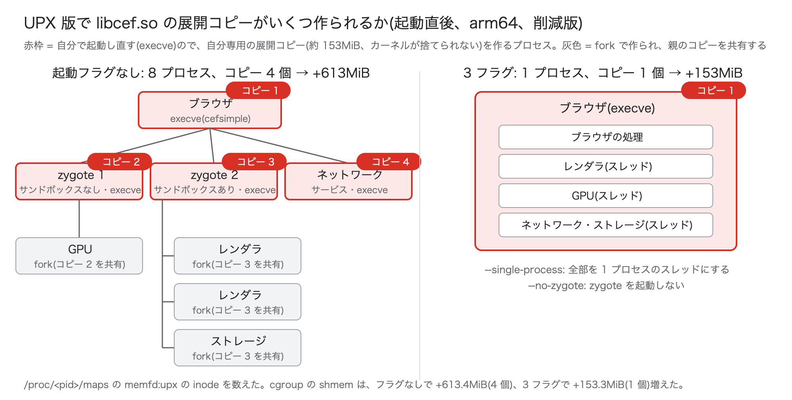

展開したコードの memfd は、`libcef.so` を読み込んだプロセスごとに作られます。fork で作られた子プロセスは親の memfd をそのまま共有しますが、自分を起動し直す(execve する)プロセスは、読み込みからやり直すので自分の memfd を作ります。

起動直後に各プロセスの `/proc/<pid>/maps` で memfd を数えました。

| 起動フラグ | プロセス | 自分の memfd を持つプロセス(execve で起動) | memfd を共有するプロセス(fork で作成) | cgroup の shmem の増加 |
|---|---|---|---|---|
| なし | 8 | ブラウザ、zygote 2 つ(サンドボックスなし / あり)、ネットワークサービス | GPU、レンダラ 2 つ、ストレージ | +613.4MiB |
| 3 フラグ | 1 | ブラウザ | (なし。すべてスレッド) | +153.3MiB |

1 プロセスあたり約 153MiB で、起動フラグなしは 4 個分、3 フラグは 1 個分です。zygote は子プロセスを fork で作るための待機プロセスで、レンダラ、GPU、ストレージは zygote から作られるので、増えません。タブを増やしてもレンダラは zygote から作られるので、増え方は変わらない見込みです(参考記事ではタブ数を変えても増加量が変わらないことを確かめている。CEF では未計測)。

## 参考記事より増え方が小さい理由

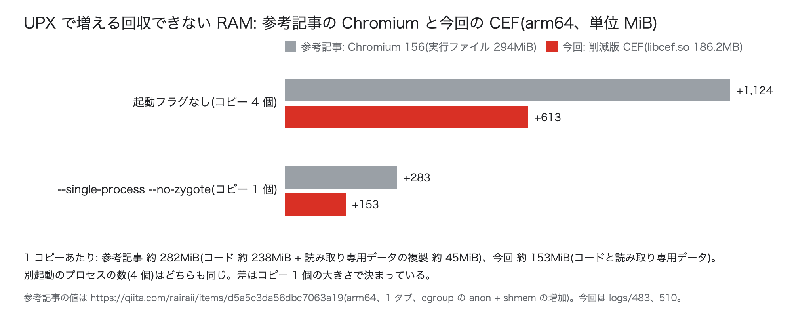

参考記事(arm64、Chromium 156、1 タブ)の回収できない RAM の増加は、起動フラグなしで +1,124MiB、`--single-process --no-zygote` で +283MiB でした。今回は +613MiB と +153MiB で、どちらも参考記事の約 55% です。

| | 参考記事 | 今回 |
|---|---|---|
| 圧縮したもの | Chromium の実行ファイル `chromium`(294MiB) | 削減版の `libcef.so`(186.2MB) |
| 展開コピーの数(起動フラグなし) | 4(ブラウザ、zygote 2 つ、ユーティリティ) | 4(ブラウザ、zygote 2 つ、ネットワークサービス) |
| 1 コピーあたりの増加 | 約 282MiB(コード 約 238MiB の memfd + 読み取り専用データ 約 45MiB の匿名メモリ) | 約 153MiB(コードと読み取り専用データを合わせた memfd) |

プロセスの数は同じで、差は 1 コピーの大きさです。理由は 2 つあります。

- 展開するコードが小さい。削減版の `libcef.so` の実行コードのセグメントは 166.7MiB(`readelf` の値。このうち約 14MiB は、UPX の展開処理を含めてファイルからそのまま読み込まれるので、memfd の 1 コピーは約 153MiB になる)で、参考記事の `chromium` のコードのマッピング(237.3MiB)の約 70%。ROM の削減(Blink のモジュールや //chrome 層の機能を外したこと)が、そのまま 1 コピーの大きさに効いている
- 読み取り専用データが二重にならない。参考記事の `chromium` は読み取り専用データが別のセグメントにあり、UPX はそれを匿名メモリに展開していた(約 45MiB)。今回は `--no-rosegment` でコードと同じセグメントにしたので、memfd の中に入る。3 フラグで anon(匿名メモリ)は 37.0 → 35.9MiB で、増えていない

## マルチプロセスのまま UPX 版の RAM を抑える

3 フラグは RAM の増加を最も小さくしますが、`--single-process` でレンダラのプロセス分離とサンドボックスを手放します。ここでは、UPX で ROM を削った版を、レンダラを別プロセスにしたまま使い、RAM の増加をどこまで抑えられるかを確かめました。

手段は、自分を起動し直す(execve する)プロセスを減らすことです。展開コピーの数は execve するプロセスの数で決まります。参考記事が試した起動フラグを CEF でも試しました。

| 起動フラグ | execve するプロセス | プロセス | 構成 | PSS(A + B) | A: 回収できない分のうちプロセスが触ったページ | B: ファイル由来の RAM | 回収できない RAM(cgroup) | 動作確認 |
|---|---|---|---|---|---|---|---|---|
| なし | 4 | 8 | CEF 既定 | 387.6MiB | 159.2MiB | 228.7MiB | 160.5MiB | 7/7 |
| なし | 4 | 8 | 削減版 | 235.3MiB | 93.7MiB | 141.4MiB | 102.1MiB | 7/7 |
| なし | 4 | 8 | 削減版 + UPX | 336.5MiB | 309.4MiB | 27.1MiB | 715.4MiB | 7/7 |
| プロセス削減フラグ | 2 | 5 | CEF 既定 | 289.1MiB | 80.2MiB | 208.9MiB | 88.0MiB | 7/7 |
| プロセス削減フラグ | 2 | 5 | 削減版 | 208.8MiB | 68.0MiB | 140.7MiB | 76.0MiB | — |
| プロセス削減フラグ | 2 | 5 | 削減版 + UPX | 250.7MiB | 224.2MiB | 26.5MiB | 382.9MiB | 7/7 |
| 3 フラグ | 1 | 1 | CEF 既定 | 266.1MiB | 58.0MiB | 208.2MiB | 65.7MiB | — |
| 3 フラグ | 1 | 1 | 削減版 | 188.5MiB | 48.8MiB | 139.7MiB | 56.7MiB | 一部 |
| 3 フラグ | 1 | 1 | 削減版 + UPX | 188.5MiB | 162.9MiB | 25.6MiB | 210.0MiB | 一部 |

プロセス削減フラグは `--in-process-gpu --no-unsandboxed-zygote --enable-features=NetworkServiceInProcess2` です。動作確認の 7/7 は 7 項目すべてが通ったこと、「一部」は機能の有無のページと YouTube の再生だけを確かめたこと、「—」は確かめていないことを示します。

プロセス削減フラグの内容と、UPX を使わない場合の効果は「RAM の削り方」の「プロセスの数を減らす起動フラグ」に書きました。

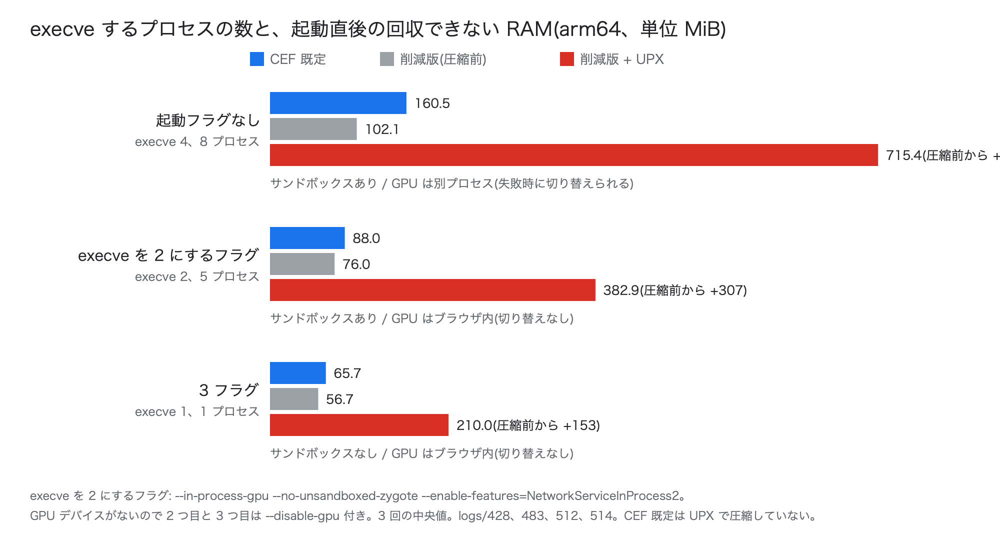

展開コピーは 2 個(ブラウザと、サンドボックスありの zygote)で、削減版の圧縮前からの増加(+307MiB)は 3 フラグ(+153MiB)の 2 倍です。この組み合わせでは、レンダラは別プロセスのままで、サンドボックスも残ります。`--single-process` は Chromium がサポートしていない動作モードで、サンドボックスがなく、レンダラが落ちるとブラウザごと落ちます。UPX を使う場合でも、3 フラグを使えない製品ではこちらが候補になります。GPU デバイスがないので、どちらも `--disable-gpu` を付けて測りました。

## UPX を使うべきか

**所見: ROM と RAM のどちらが厳しいかで使い分けます。** ROM が足りず、3 フラグ(`--single-process` を含む)を受け入れられる機器では、UPX は有効な選択肢です。標準のマルチプロセスで動かす機器や、ROM に余裕があって RAM が厳しい機器では使いません。ROM を減らす手段としては、圧縮ファイルシステムとも比べます。

### RAM の増え方は 2 通りの見方で幅がある

UPX で減るのはファイル由来の RAM で、増えるのは回収できない RAM です。どちらを RAM の使用量として見るかで、増え方が変わります。

| 起動フラグ | 場面 | PSS(A + B)の増加 | 回収できない RAM(cgroup)の増加 | cgroup + B の増加 |
|---|---|---|---|---|
| 3 フラグ | 起動直後 | ±0MiB(188.5 → 188.5) | +153MiB(56.7 → 210.0) | +39MiB(196.4 → 235.6) |
| 3 フラグ | H.264 1080p 再生中 | −12.5MiB(694.0 → 681.5) | +141MiB(537.7 → 679.0) | +8MiB(702.9 → 710.9) |
| プロセス削減フラグ | 起動直後 | +42MiB(208.8 → 250.7) | +307MiB(76.0 → 382.9) | +193MiB(216.7 → 409.4) |
| なし | 起動直後 | +101MiB(235.3 → 336.5) | +613MiB(102.1 → 715.4) | +499MiB(243.5 → 742.5) |
| なし | H.264 1080p 再生中 | +130MiB(757.7 → 887.6) | +768MiB(598.3 → 1,366.2) | +633MiB(765.6 → 1,398.7) |

PSS は展開したコードのうち触っていないページを数えないので、UPX の負担を小さく見せます。使用量の見方としては、cgroup の値だけで比べるか、cgroup に B を足して比べるかの 2 つを使います。

- cgroup の値だけで比べる見方は、圧縮前のファイル由来の RAM(B)をカーネルがすべて捨てられる、という前提です
- cgroup に B を足して比べる見方は、ファイル由来の RAM がメモリに載ったままになる、という前提です

実際の機器では、後者に近いと考えます。ファイル由来の RAM の大部分は、実行中のコードとデータです。カーネルがこれを捨てると、すぐに読み直しが起き、動作が遅くなります。メモリの上限をかけた再生では、上限に近づいても約 100〜130MiB のファイル由来のページは捨てきれずに残っていました(「メモリの上限をかけたとき」)。

この見方では、3 フラグと組み合わせた UPX の RAM の増加は 8〜39MiB で、ROM の削減(100.7MB)に比べて小さくなります。標準のマルチプロセスでは、どちらの見方でも ROM の削減を大きく上回ります。

### RAM には余裕を見る

圧縮前の「カーネルが実行コードのページを捨てて縮められる」という利点は、メモリが足りなくなったときにしか効きません。その状態では読み直しで動作が遅くなり、さらに足りなくなれば強制終了されます。Chromium は cgroup の上限を見ておらず、上限に近づいても自分からメモリを手放しません(「メモリの上限をかけたとき」)。実行コードのページを捨てなければ収まらない設計では、UPX の有無にかかわらず、いつ強制終了されてもおかしくありません。

そのため、RAM の割り当ては、回収できない RAM に、実行中に使うファイル由来の RAM と余裕を足して決めます。今回の上限の試験では、回収できない RAM の最大値に約 100MiB を足した上限で強制終了される条件があり、約 200MiB を足すとどの条件でも再生できました。この考え方で決めると、UPX を使っても使わなくても、必要な割り当ての差はファイル由来も含めた増加(3 フラグで 8〜39MiB)に近くなる見込みです。UPX 版に上限をかけた再生は試していないので、実機で採用するときは上限をかけて確かめます。

### 使い分け

| 機器の条件 | 判断 | 根拠 |
|---|---|---|
| ROM が足りない。3 フラグ(サンドボックスなし、1 プロセス)を受け入れられる | UPX を使う候補 | ROM −100.7MB に対し、RAM の増加は 8〜39MiB(ファイル由来を含む)、141〜153MiB(回収できない分だけ)。CEF 既定を 3 フラグで動かす場合と比べると、再生中の回収できない RAM は +17MiB、ROM は 26% |
| ROM が足りない。レンダラを別プロセスにしてサンドボックスを残したい | プロセス削減フラグと組み合わせれば候補。RAM の余裕を確かめる | 起動直後の増加 +193MiB(ファイル由来を含む)、+307MiB(回収できない分だけ) |
| 標準のマルチプロセスで動かす | 使わない | 起動直後でも +499MiB 以上 |
| ROM に余裕があり、RAM が厳しい | 使わない | ROM を減らす必要がなく、RAM が増えるだけ |
| 圧縮ファイルシステム(squashfs など)を使える | まずそちらと比べる | 削減版、SwiftShader なしの配布物のファイル(ロケールは ja と en-US。合計 194.6MB)が 194.6MB → 60.7MB(xz、ブロック 1MiB)、69.5MB(zstd レベル 19)、85.6MB(gzip、128KiB)。RAM と起動時間は未計測 |

3 フラグの `--single-process` は Chromium がサポートしていない動作モードで、サンドボックスがなく、レンダラが落ちるとブラウザごと落ちます。UPX を使うかどうかより先に、このモードを製品で使えるかの判断が要ります。

squashfs のような圧縮ファイルシステムでは、読み出したページは展開後の内容がページキャッシュに入り、ファイル由来の RAM として扱われます。プロセス間で共有され、メモリが足りなければ捨てて読み直せます。ただし、今回測ったのはサイズだけで、RAM、起動時間、ページを読み直すときの展開の負荷は測っていません。

# パッチとソースコード

パッチ、GN 引数、計測用のスクリプト、計測結果は次のリポジトリにあります。

https://github.com/aRaikoFunakami/CEF_M158_Investigation

| パス | 内容 |
|---|---|
| `patches/chromium/e3b-final-clean.patch` | タグ `158.0.8127.18` からの差分。CEF 自身のパッチと手順 1〜3 の変更を含む(517 ファイル) |
| `patches/chromium/f4b.patch` | 上の状態からの差分。手順 4〜8 の変更(348 ファイル) |
| `patches/cef/f4b-cef.patch` | CEF のコミット `6ee3fb965` からの差分(16 ファイル) |
| `patches/chromium/g2.patch` | arm64 版で足した GN 引数 `enable_media_remoting=false` を通すための 2 ファイル |
| `patches/new-files/` | パッチに含まれない新規ファイル 3 つ |
| `patches/chromium/upx-noifunc.patch` | UPX のために IFUNC を普通の関数に置き換えるパッチ(PartitionAlloc の 2 ファイル)。リンカオプション `-Wl,--no-rosegment` と合わせて使う |
| `args/` | 各段階の `args.gn` |
| `scripts/measure/` | 計測用のスクリプト(サイズ、起動直後の RAM、YouTube の再生中の RAM、動作確認) |
| `scripts/patch/pakstrip.py` | `resources.pak` の作り直し |
| `data/` | 計測結果(JSON、TSV) |
| `docs/` | 調査の記録 |

リポジトリの中では、各段階を調査中の名前で呼んでいます。対応は次のとおりです。

| 記事での名前 | リポジトリでの名前 |
|---|---|
| x64 の CEF 既定 | E1 |
| x64 の手順 1、2、3 | E2、E3a、E3b |
| x64 の手順 4、5、6、7、8 | F1a、F2、F2b1、F4a、F4b |
| x64 の削減版(手順 9) | F4b-dist |
| arm64 の CEF 既定 | G0 |
| arm64 の削減版(Cobalt 由来の GN 引数と配布物の整理を入れる前) | G1 |
| arm64 の削減版 | G2-dist |
| arm64 の削減版、SwiftShader なし | G2-tv |
| arm64 の削減版、SwiftShader なし、UPX 用の変更(圧縮前 / 圧縮後) | G2-tv-ni-strip / G2-tv-ni-upx |

`e3b-final-clean.patch`、`f4b.patch`、`f4b-cef.patch` の 3 つは、タグと CEF のコミットに順に当たることを確認しています(作業中のソースに触れない一時インデックスでの `git apply --check`)。手順は README に書きました。ただし、新しいソースツリーでこの手順を最初から通してビルドしたことはありません。

# 未確認のこと

- ハードウェアデコーダのある実機での RAM
- TV 向けの YouTube(`youtube.com/tv`)での計測。今回は PC 向けのページで測った
- 4K の VP9、720p 以下の解像度
- メモリの上限の境界(再生できる最小値)
- 再生中の PSS が同じ条件で約 180MiB 違う回がある原因(JavaScript のメモリが 80〜89MiB の回と 105〜121MiB の回に分かれる)
- `-Os` の速度への影響
- Chromium の Linux 向けリリースビルドで既定で有効になっている、実行時のプロファイルを使う最適化(PGO、`chrome_pgo_phase=2`)がサイズに与える影響
- 実機の GPU での描画(`--use-gl=angle --use-angle=gles` など、「実機で GPU を使う場合」の対策)
- UPX 版にメモリの上限をかけた再生、squashfs に置いた場合の RAM と起動時間
- //chrome 層をさらに外すパッチの効果(CEF のままで −15〜25MB の見込み。Blink のバインディングの除外、V8 と ICU の設定、コンパイラの設定の見直しを合わせた推定で、検証していない)

# Appendix: 途中で起きた問題

途中で起きた問題と、最終的な対処です。

## ビルド

| 問題 | 対処 |
|---|---|
| siso(Chromium の既定のビルドツール)が、子プロセスの終了を待ったまま止まる | ninja でビルドする(GN 引数 `use_siso=false`)。停止を検知して再実行するラッパー(`scripts/build/fpbuild.py`)を使い、停止はコンパイラやリンカのプロセスが動いているかで判定する |
| CEF の `automate-git.py` が Chromium の全履歴を取得する | Chromium はタグだけを浅く取得し(`git fetch --depth=1`)、依存は `gclient sync --no-history` で取得する |
| `gn gen` が通っても、コンパイル、リンク、起動のどこかで失敗する GN 引数がある | GN 引数はクリーンビルドと起動で確かめ、通ったものだけを使う(リポジトリの `args/`) |
| 差分ビルドで通ったパッチが、クリーンビルドで失敗する(古い自動生成のヘッダが残っていた) | パッチはクリーンビルドで確かめる |
| `enable_mdns` など、効果のない GN 引数がある(3 つで −0.1MB) | 使わない |
| Rosetta 上で、開発者ツールのビルド中に TypeScript のコンパイラ(`tsc`)が落ちることがある | 再実行する |

## 計測

| 問題 | 対処 |
|---|---|
| YouTube が "Something went wrong" で止まることがある(全構成で起きる。原因は不明) | 最後まで再生できた回だけを数える。YouTube を一度開いたプロファイルを毎回コピーして使う |
| Rosetta 上では `/proc/<pid>/exe` が Rosetta 本体を指し、ブラウザのプロセスを見つけられない | 起動時のコマンド名(`argv[0]`)で照合する |
| Chrome DevTools Protocol で注入した、H.264 を選ばせるスクリプトが効かない | `Page.addScriptToEvaluateOnNewDocument` の前に `Page.enable` を呼ぶ |
| 4K で AV1 が選ばれない | `mediaCapabilities` で「AV1 は省電力で再生できる」と答えさせる |
| メモリに上限をかけた計測で、最後に取るメモリの内訳のダンプのせいで強制終了される | 上限をかけたときはダンプを取らない |
| cgroup の最大使用量(`memory.peak`)をリセットできない | 10 秒おきに読んだ値から最大値を取る |
| UPX で圧縮した `libcef.so` が読み込み時に落ちる | `-Wl,--no-rosegment` でリンクし、IFUNC を普通の関数に置き換える(「UPX で圧縮する」) |
| SwiftShader なしの版を `--single-process` で起動すると落ちる | SwiftShader 用の起動フラグを外し、`--disable-gpu` を付ける(GPU のある機器では「実機で GPU を使う場合」) |
